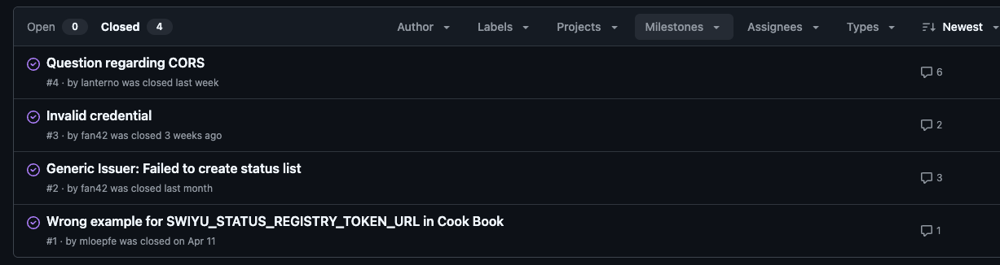

# Week 18 - April 28th

**Tested the SWIYU application as a wallet holder**  
- using this [SWIYU cookbook](https://swiyu-admin-ch.github.io/cookbooks/how-to-use-beta-id/)
    - Requested credential from [this PoC website](https://www.bcs.admin.ch/bcs-web/#/).
- Both Android and IOS applications are working on their respective stores.

### Remarks
- The process is a lot easier than before, specifically, the wallet holder only scans a QR code once, after the credential has been created. 

- It’s unclear if the issuer is able in this case to issue other credentials to the holder without the holder scanning another QR code.  
    - Indy: Connection is established first – very similar to a phone contact 
    - SWIYU: QR code contains Credential information. 

**Goal: Integrate our first E-ID testbed demo app (with Indy) with the new SWIYU infrastructure – Issuer workflow**

Steps: 

1. Initial setup and creating a DID document 
    - Followed the cookbook here 
2. Install the backend for the issuer  
    - Followed this cookbook here 
    - Fill all environment variables coming from step 1 
3. Make the server accessible from the local network  
4. Connect with Wallet from phone 

### Remarks: 
- Instructions were confusing and I had to repeat the process a couple of times.  
- I wrote a script that helps reduce duplications but is still not automated fully. 
- Backend had multiple issues:  

    

 	Luckily, most of my issues have already been answered which helped a lot to move forward. 

    *But it took a lot of time before connecting the problems I was facing with these on the list above.*

At the end of this week, there’s a working backend that can issue credentials, but when creating the QR code, the SWIYU app doesn’t read it.  

**Decision: based on last time experience, let’s use typescript to convert the credential offer link into a QR code that can be scanned from the browser.**
